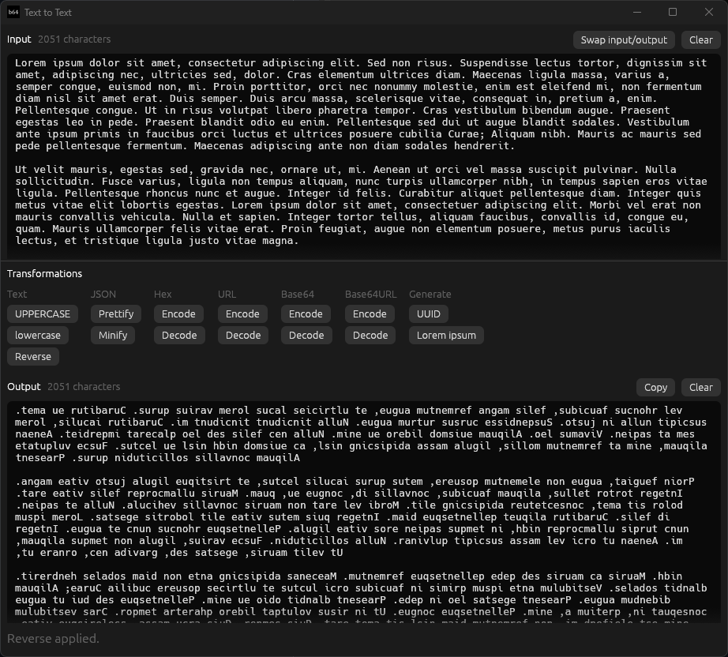

# Text to Text

A small desktop utility for converting text from one format to another. Type or
paste into the top box, click a transformation, and the result appears in the
bottom box.

Built in Rust with [egui](https://github.com/emilk/egui) and
[eframe](https://crates.io/crates/eframe). Everything runs locally — no network
access and no telemetry.



## Features

- **Two large text areas** — input on top, output on the bottom, both monospace
  with live character counts.
- **Transformation groups in columns** — Text, JSON, Hex, URL, Base64, Base64URL,
  and Generate.
- **Flexible layout** — the button bar keeps a fixed height. Drag the divider
  below the input box to resize the split; the output box always fills the
  remaining space.
- **Handy actions** — swap the input and output, copy the result, or clear either
  box.
- **Status bar** — confirms the last action or shows parse/decode errors in red
  without overwriting the existing output.

## Transformations

| Group     | Actions                     | Notes                                                                              |
| --------- | --------------------------- | ---------------------------------------------------------------------------------- |
| Text      | UPPERCASE, lowercase, Reverse | Unicode-aware casing; Reverse works on characters                                |
| JSON      | Prettify, Minify            | Validates the JSON and preserves object key order                                  |
| Hex       | Encode, Decode              | Encodes UTF-8 bytes; the decoder ignores whitespace and accepts upper/lowercase    |
| URL       | Encode, Decode              | Percent-encodes all non-alphanumeric characters; decodes back to UTF-8             |
| Base64    | Encode, Decode              | Standard padded alphabet; the decoder tolerates whitespace and URL-safe input      |
| Base64URL | Encode, Decode              | URL-safe alphabet; the decoder accepts padded or unpadded input                    |
| Generate  | UUID, Lorem ipsum           | Creates a random v4 UUID or a classic Lorem ipsum paragraph (input is ignored)     |

## Getting started

Requires Rust 1.95 or newer (the app uses eframe/egui 0.37). On Windows you need
the MSVC build tools; on Linux, the usual eframe/winit packages for X11 or
Wayland.

```sh
cargo run --release
```

For a faster edit/compile loop, use `cargo run` (debug build). The release binary
is written to `target/release/text-to-text` (`text-to-text.exe` on Windows).

## Project layout

```
Cargo.toml
about.toml            cargo-about configuration
about.hbs             template for the third-party notices
src/
  main.rs             App state, window layout, panels, and widgets
  transform.rs        Transform enum, transformation logic, unit tests
assets/
  screenshot.png
THIRD-PARTY-NOTICES.md  generated dependency licenses
```

## Adding a transformation

All transformations live in `src/transform.rs`:

1. Add a variant to `Transform`.
2. Add it to `Transform::GROUPS` — each group is rendered as a column.
3. Give it a button label and a full name for status messages.
4. Handle it in `Transform::apply`, returning `Ok(result)` or `Err(message)`.

The UI picks new buttons up automatically. If a new group makes the toolbar too
wide, raise the minimum window width in `src/main.rs`.

## Tests

```sh
cargo test
```

The 16 unit tests cover the transformations, including Unicode round-trips and
error cases.

## Third-party notices

Every dependency is permissively licensed (MIT, Apache-2.0, BSD, ISC, Zlib,
Unicode, and similar), which is compatible with GPL-3.0. `THIRD-PARTY-NOTICES.md`
lists each crate with its version and license and reproduces the full license
texts, including those for the fonts embedded by egui.

The file is generated with [cargo-about](https://github.com/EmbarkStudios/cargo-about).
Regenerate it whenever dependencies change:

```sh
cargo install --locked --features cli cargo-about
cargo about generate --locked --fail -o THIRD-PARTY-NOTICES.md about.hbs
```

Ship `THIRD-PARTY-NOTICES.md` and `LICENSE` with binary releases.

## License

GPL-3.0-only — see [LICENSE](LICENSE).
